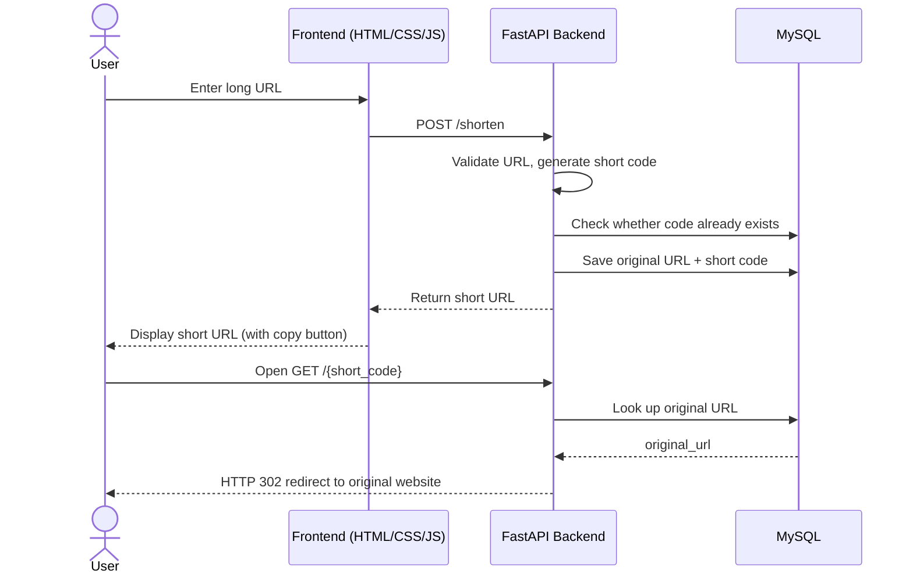

<div align="center">

# 🔗 Linkly

**A full-stack URL shortener built with FastAPI, MySQL, and vanilla JavaScript.**

Turn long URLs into short, shareable links and redirect visitors to the original destination.

<br>


<br>

[Features](#-features) •
[Tech Stack](#-technology-stack) •
[Architecture](#-architecture-and-request-flow) •
[API](#-api-endpoints) •
[Setup](#-local-development-setup) •
[Roadmap](#-limitations-and-future-improvements)

</div>

---

## 📖 Overview

**Linkly** is a full-stack URL shortener developed and run locally as a learning and portfolio project.

A user pastes a long URL into the web interface. The frontend sends it to a Python **FastAPI** backend, which generates a random six-character short code, stores the mapping between the code and the original URL in **MySQL**, and returns the shortened link. When someone opens the short link, the backend looks up the original URL and redirects the visitor to it.

> **Note:** Linkly currently runs on a local development setup only. It is not deployed publicly and has not been hardened for production use.

---

## ✨ Features

- Long URL input through a web interface
- URL validation using Pydantic's `HttpUrl`
- Random six-character short-code generation (uppercase letters, lowercase letters, and digits) using Python's `secrets` module
- Database lookup to avoid reusing an existing short code, with up to five retries on collision
- Storage of original URLs and their short codes in MySQL
- Shortened URL returned to the frontend
- HTTP `302` redirect from a short code to the original URL
- HTTP `404` response for unknown short codes
- Copy button in the frontend to copy the generated short URL
- Responsive, dark-themed, glassmorphism-style user interface

---

## 🛠 Technology Stack

| Layer | Technologies |
|---|---|
| **Frontend** | HTML5, CSS3, Vanilla JavaScript, Fetch API |
| **Backend** | Python, FastAPI, Uvicorn (ASGI server), Pydantic |
| **Database** | MySQL, `mysql-connector-python` |
| **Configuration** | `python-dotenv` for environment variables |
| **Short-code generation** | Python `secrets` and `string` modules |
| **Local development** | VS Code Live Server (for the frontend) |

---

## 📁 Project Structure

```text
Linkly/
├── backend/
│   ├── main.py          # FastAPI app, endpoints, short-code generation
│   └── database.py      # MySQL connection logic
├── frontend/
│   ├── index.html       # Page structure
│   ├── style.css        # Dark glassmorphism styling
│   └── script.js        # Fetch API calls and copy button logic
├── .gitignore
└── README.md
```

> A local `backend/.env` file (database credentials) and a `backend/venv/` virtual environment are used during development, but **both are intentionally excluded from the repository**. See [Security Notes](#-security-notes).

---

## 🏗 Architecture and Request Flow

The diagram below shows the **intended request flow** of the application when run locally.



<details>
<summary>Plain-text version of the flow</summary>

```text
User
  |
  v
HTML/CSS/JavaScript Frontend
  |
  | POST /shorten
  v
FastAPI Backend
  |
  | Generate short code
  | Check existing codes
  v
MySQL Database
  |
  | Save original URL + short code
  v
FastAPI returns short URL
  |
  v
User opens short URL
  |
  | GET /{short_code}
  v
FastAPI queries MySQL
  |
  | HTTP 302 redirect
  v
Original destination website
```

</details>

---

## 🔌 API Endpoints

The backend runs locally at `http://127.0.0.1:8000`. FastAPI also provides interactive documentation at `http://127.0.0.1:8000/docs`.

### `POST /shorten`

Creates a shortened URL.

**Request body**

```json
{
  "original_url": "https://www.example.com/some/long/path"
}
```

**How it works**

1. Validates the supplied URL with Pydantic (`HttpUrl`).
2. Opens a MySQL connection.
3. Generates a six-character short code.
4. Checks whether the code already exists in the database.
5. Retries generation up to five times if a collision occurs.
6. Inserts the original URL and short code into MySQL.
7. Commits the transaction.
8. Returns a JSON response.

**Example response**

```json
{
  "message": "URL shortened successfully",
  "original_url": "https://www.example.com/some/long/path",
  "short_code": "aB12xY",
  "short_url": "http://127.0.0.1:8000/aB12xY"
}
```

> The short code `aB12xY` is illustrative. A new random code is generated for each request.

> **Local development note:** the short URL is currently built using the backend address `http://127.0.0.1:8000`. For a deployed environment, this base URL would need to be made configurable.

---

### `GET /{short_code}`

Redirects the visitor to the original URL.

**How it works**

1. Receives the short code from the URL path.
2. Queries MySQL for the matching `original_url`.
3. Returns **HTTP 404** if no matching code exists.
4. Otherwise, issues an **HTTP 302** redirect to the original URL using FastAPI's `RedirectResponse`.

**Example local link**

```text
http://127.0.0.1:8000/aB12xY
```

### Response summary

| Endpoint | Method | Success | Error |
|---|---|---|---|
| `/shorten` | `POST` | JSON with short URL | Validation error for invalid URLs |
| `/{short_code}` | `GET` | `302` redirect | `404` if the code does not exist |

---

## 🗄 Database Setup

| Setting | Value |
|---|---|
| Database name | `url_shortener` |
| Table name | `urls` |

The backend uses these columns:

| Column | Purpose |
|---|---|
| `id` | Record identifier |
| `original_url` | Original long URL |
| `short_code` | Generated short code |

### Example SQL

> ⚠️ **This SQL is an example.** The exact table definition used by the original project has not been verified. Make sure your table matches the columns the backend queries use (`id`, `original_url`, `short_code`) and adjust types or constraints if your setup differs.

```sql
CREATE DATABASE IF NOT EXISTS url_shortener;
USE url_shortener;

CREATE TABLE IF NOT EXISTS urls (
    id INT AUTO_INCREMENT PRIMARY KEY,
    original_url TEXT NOT NULL,
    short_code VARCHAR(10) NOT NULL UNIQUE
);
```

---

## 🚀 Local Development Setup

These instructions are written for **Windows with PowerShell** and assume you have already cloned or downloaded the repository.

### Prerequisites

- [Python](https://www.python.org/downloads/) installed
- [MySQL Server](https://dev.mysql.com/downloads/mysql/) installed and running
- [Git](https://git-scm.com/) (if cloning the repository)
- [VS Code](https://code.visualstudio.com/) with the **Live Server** extension (or another static file server)

### Step 1 — Clone the repository (optional)

```powershell
git clone https://github.com/RohaanAhmadQuadri/Linkly.git
cd Linkly
```

### Step 2 — Create the database and table

Create the `url_shortener` database and the `urls` table using MySQL Workbench or the MySQL command-line client. See [Database Setup](#-database-setup) for the example SQL.

### Step 3 — Open the backend directory

From the project root:

```powershell
cd backend
```

### Step 4 — Create and activate a virtual environment

```powershell
python -m venv venv
.\venv\Scripts\Activate.ps1
```

> If PowerShell blocks the activation script, you can allow it for the current session only:
>
> ```powershell
> Set-ExecutionPolicy -Scope Process -ExecutionPolicy Bypass
> ```

### Step 5 — Install dependencies

```powershell
python -m pip install fastapi uvicorn mysql-connector-python python-dotenv
```

### Step 6 — Configure environment variables

Create a file named `.env` inside the `backend/` directory. See [Environment Variables](#-environment-variables) below.

### Step 7 — Start the backend

From the `backend` directory:

```powershell
uvicorn main:app --reload
```

The backend should now be available at:

| Resource | URL |
|---|---|
| API | `http://127.0.0.1:8000` |
| Interactive docs (Swagger UI) | `http://127.0.0.1:8000/docs` |

### Step 8 — Start the frontend

Open `frontend/index.html` with **VS Code Live Server** (right-click the file → *Open with Live Server*).

> The frontend sends requests to `http://127.0.0.1:8000`, so the backend must be running locally on that address.

If you use different database credentials, ports, or schema settings, update the configuration accordingly.

---

## ⚙️ Environment Variables

Create `backend/.env` with the following variables:

```env
DB_HOST=localhost
DB_USER=root
DB_PASSWORD=your_actual_mysql_password
DB_NAME=url_shortener
```

| Variable | Description |
|---|---|
| `DB_HOST` | MySQL server host (for example, `localhost`) |
| `DB_USER` | MySQL username |
| `DB_PASSWORD` | MySQL password. **Replace the placeholder with your own local password.** |
| `DB_NAME` | Database name (`url_shortener`) |

`backend/database.py` locates the `.env` file in the backend directory using `pathlib.Path` and loads it with `python-dotenv`.

---

## 💡 Example Usage

### Using the web interface

1. Start the backend and open the frontend with Live Server.
2. Paste a long URL into the input field.
3. Submit the form to generate a short link.
4. Click the copy button to copy the short URL.
5. Open the short URL in a browser to be redirected to the original website.

### Using the API directly (PowerShell)

```powershell
Invoke-RestMethod -Uri "http://127.0.0.1:8000/shorten" `
  -Method Post `
  -ContentType "application/json" `
  -Body '{"original_url": "https://www.example.com/some/long/path"}'
```

You can also try the endpoints from the interactive docs at `http://127.0.0.1:8000/docs`.

---

## 🔒 Security Notes

- **Never commit `backend/.env`.** It contains your database credentials.
- **Never commit database passwords or other credentials** anywhere in the repository.
- **Never upload `backend/venv/`.** Virtual environments should stay local.
- Keep `.env` values on your own machine.
- The root `.gitignore` is configured to exclude Python virtual environments, Python cache files, environment files, and local IDE/OS files.

> ⚠️ **If you accidentally commit an `.env` file**, deleting it in a later commit does **not** remove it from Git history. Treat the exposed credentials as compromised and **rotate them** (for example, change your MySQL password).

---

## 🧭 Limitations and Future Improvements

Linkly is a learning and portfolio project. It is **not** presented as production-grade in security or scalability.

**Current limitations**

- Runs locally only; not deployed
- The short URL base (`http://127.0.0.1:8000`) and the frontend API address are set for local development
- No automated tests

**Possible future work** *(not implemented)*

- [ ] Click analytics and visit counts
- [ ] Custom aliases
- [ ] QR code generation
- [ ] Link expiration
- [ ] Configurable public base URL
- [ ] Automated tests
- [ ] Deployment and production configuration
- [ ] Rate limiting and abuse prevention

---

## 👤 Author

**Rohaan Ahmad Quadri**

- GitHub: [@RohaanAhmadQuadri](https://github.com/RohaanAhmadQuadri)
- Repository: [Linkly](https://github.com/RohaanAhmadQuadri/Linkly)

---

<div align="center">

If you found this project useful or interesting, consider giving it a ⭐ on GitHub.

</div>
